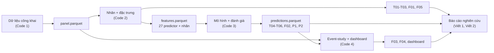

# Stablecoin Depeg Early-Warning System

**Hệ thống cảnh báo sớm rủi ro mất neo (depeg) của stablecoin bằng dữ liệu thị trường và Machine Learning.**

> **Tuyên bố miễn trừ.** Đây là thiết kế học thuật và mô phỏng nghiên cứu, **không phải khuyến nghị đầu tư**. Kết quả phụ thuộc vào dữ liệu công khai, số sự kiện rất ít và một giai đoạn lịch sử cụ thể; không dùng để ra quyết định giao dịch.

## Mục lục

1. [Giới thiệu và ý nghĩa dự án](#1-giới-thiệu-và-ý-nghĩa-dự-án)
2. [Kiến trúc hệ thống](#2-kiến-trúc-hệ-thống)
3. [Yêu cầu môi trường và cài đặt](#3-yêu-cầu-môi-trường-và-cài-đặt)
4. [Hướng dẫn vận hành](#4-hướng-dẫn-vận-hành)
5. [Cấu trúc thư mục dự án](#5-cấu-trúc-thư-mục-dự-án)
6. [Xử lý sự cố thường gặp](#6-xử-lý-sự-cố-thường-gặp)
7. [Trạng thái, kết quả và hạn chế đã biết](#7-trạng-thái-kết-quả-và-hạn-chế-đã-biết)
8. [Nhóm thực hiện](#8-nhóm-thực-hiện)

---

## 1. Giới thiệu và ý nghĩa dự án

### 1.1 Bài toán

Stablecoin được thiết kế để neo giá 1 USD, nhưng có thể lệch khỏi mức neo (*depeg*) khi niềm tin, thanh khoản hoặc tài sản đảm bảo bị sốc, như vụ Terra/UST (5/2022) hay USDC (3/2023). Dự án xây dựng hệ thống **dự báo trước** khả năng depeg của ba stablecoin lớn (USDT, USDC, DAI) ở tần suất ngày và cung cấp công cụ theo dõi trực quan.

### 1.2 Vì sao cần làm

- Depeg ảnh hưởng đến ổn định tài chính của thị trường tiền mã hóa và các tổ chức nắm giữ stablecoin làm dự trữ.
- Phân biệt được **phát hiện depeg đang xảy ra** với **cảnh báo trước khi xảy ra**. Nhiều mô hình trông tốt chỉ vì học lại việc "đang lệch thì ngày mai vẫn lệch".
- Sự kiện depeg rất hiếm, nên cách đánh giá (PR-AUC, recall theo sự kiện, so với baseline và với may rủi) quan trọng không kém bản thân mô hình.

### 1.3 Điểm làm khác

| Nguyên tắc | Cách thực hiện |
|---|---|
| Dự báo chứ không phát hiện | Nhãn là *onset* (sự kiện depeg **mới bắt đầu** trong (t, t+h]); quan sát đã ở trạng thái depeg tại t bị loại khỏi mẫu |
| Point-in-time | Mọi feature chỉ dùng dữ liệu ≤ t; có test chống look-ahead |
| Đánh giá đúng bài toán hiếm | PR-AUC làm chính, recall theo sự kiện, lead time, so với baseline ngây thơ và với mốc may rủi |
| Test set không bị động tới | Chọn mô hình, ngưỡng, hiệu chuẩn bằng walk-forward trên train + validation; test chạy **một lần** (có khóa tệp) |
| Giải thích được | SHAP, top 3 driver cho từng quan sát trên dashboard |

### 1.4 Câu hỏi nghiên cứu

- **RQ1:** Biến nào báo trước depeg mạnh nhất?
- **RQ2:** Thanh khoản/dòng cung hay lịch sử giá quan trọng hơn?
- **RQ3:** Predictor có khác nhau giữa các loại stablecoin không?
- **RQ4:** ML có tăng recall mà không tạo quá nhiều báo động giả so với baseline không?
- **RQ5:** Có dấu hiệu depeg đồng thời (co-depeg) giữa các stablecoin không?

### 1.5 Phạm vi

USDT, USDC, DAI · dữ liệu ngày từ 01/01/2020 đến 16/10/2026 · nhãn depeg ở ngưỡng 0,5%, 1%, 2% (chính: 1%, m = 1) · horizon h = 1 ngày (chính) và 3 ngày · Logit, Random Forest, XGBoost, baseline ngây thơ · event-study · dashboard Streamlit.

---

## 2. Kiến trúc hệ thống

### 2.1 Luồng dữ liệu



### 2.2 Thiết kế chống rò rỉ dữ liệu

- Tập dữ liệu chia theo thời gian: **train 2020–2021, validation 2022, test 2023 đến 16/10/2026**. Nhãn chỉ đủ điều kiện khi toàn bộ horizon nằm trong cùng split.
- Walk-forward mở rộng trên train + validation, 4 khối nửa năm (2021H1 đến 2022H2); mỗi fold chỉ huấn luyện trên dữ liệu trước khối, cách khối h + m ngày (purge).
- Stage `dev` **không nạp** hàng thuộc split test. Stage `test` đọc bản đóng băng `model_freeze.json` và tạo khóa `outputs/test_run.lock.json`; có khóa thì script từ chối chạy lại.
- Các cột nhãn, `depeg_state_t`, `split`, `hl_supported_*` bị cấm làm predictor (có kiểm tra trong mã và test).

## 3. Yêu cầu môi trường và cài đặt

### 3.1 Yêu cầu

| Hạng mục | Yêu cầu |
|---|---|
| Hệ điều hành | Windows, macOS hoặc Linux. Lệnh mẫu viết cho PowerShell; trên bash đổi đường dẫn tương ứng |
| Python | 3.10 trở lên |
| Thư viện lõi | `pandas`, `numpy`, `scikit-learn`, `PyYAML`, `matplotlib`, `seaborn`, `pyarrow` |
| Mô hình và giải thích | `xgboost`, `shap` |
| Kiểm thử | `pytest` |
| Dashboard | `streamlit`, `plotly` |
| Mạng | Chỉ cần cho thẻ "Giá thị trường mới nhất" của dashboard (Binance public API). Pipeline nghiên cứu chạy offline từ panel |
| Phần cứng | Máy thông thường là đủ |

### 3.2 Cài đặt

```powershell
git clone <đường-dẫn-repo>
cd <thư-mục-repo>
python -m venv .venv
.venv\Scripts\Activate.ps1                    # macOS/Linux: source .venv/bin/activate

# Cài đặt thư viện
pip install -r requirements.txt

# Lưu phiên bản thực tế để tái lập
pip freeze > requirements.lock.txt
python --version
```

### 3.3 Kiểm tra cài đặt

```powershell
python -c "import pandas, sklearn, xgboost, shap, pyarrow; print('OK')"
```

---

## 4. Hướng dẫn vận hành

### 4.1 Quy tắc chung

- **Luôn chạy từ thư mục gốc repo** và dùng dạng `python -m ...` để import `src` đúng.
- Tham số (ngưỡng, m, h, seed, ngày chia split, lưới tham số) nằm trong `config/`, không sửa trong mã.
- Không sửa tay dữ liệu ở `raw/`; mọi biến đổi đi qua script.

### 4.2 Chạy toàn bộ pipeline

| Bước | Lệnh | Kết quả | Người chạy |
|---|---|---|---|
| 0 | Panel: dùng bản có sẵn tại `Stablecoin-EWS_Code1_backup_no_onchain/data/processed/panel.parquet`. | `panel.parquet` |
| 1 | `python -m src.features.labels` | `data/interim/labels.parquet`, T01, T02 |
| 2 | `python -m src.features.features` | `data/processed/features.parquet` |
| 3 | `python -m src.models.code2_logit` | T03 và `T03_logit_bootstrap_metadata.json` (vài phút) |
| 4 | `python -m src.visualization.code2_figures` | F01, F05 | 
| 5 | `python -m src.models.code3_models --stage dev` | `outputs/dev/*` gồm `model_freeze.json`, T04/T05/T05b/T06 bản dev, F02 dev |
| 6 | Chốt mô hình: commit `config/code3.yaml`, `outputs/dev/model_freeze.json`, `docs/code3_decision_log.md`, gắn tag `code3-freeze` | Điểm chốt trước khi chạy test |
| 7 | `python -m src.models.code3_models --stage test --dry-run` rồi xóa `outputs/dry_run/` | Kiểm tra đường mã, **không** đụng split test |
| 8 | `python -m src.models.code3_models --stage test` | **Chỉ một lần.** T04, T05, T05b, T06, P1, F02, `outputs/predictions.parquet`, khóa `test_run.lock.json` |
| 9 | `python -m src.models.code3_models --stage robustness` | P2 (chỉ đo độ nhạy, sau khi test đã chạy) |
| 10 | `python -m src.evaluation.make_f03_event_study` và `python -m src.evaluation.make_f04_warning_probability` | F03, F04 |
| 11 | `streamlit run dashboard/app.py` | Dashboard |
| 12 | `python -m pytest -q -p no:cacheprovider` | Kiểm thử toàn bộ

Muốn chạy lại từ máy sạch (tái lập): làm tuần tự bước 1–12 trên bản clone mới và so sánh `cv_pr_auc` trong `model_freeze.json` với bản đã commit.

### 4.3 Quy tắc về test set

- Test set (2023 đến 16/10/2026) chỉ được chấm **một lần**, sau khi mô hình và ngưỡng đã đóng băng.
- Nếu `outputs/test_run.lock.json` đã tồn tại, script dừng. **Không xóa khóa** để chạy lại.
- Nếu bước 8 dừng vì lỗi kỹ thuật (thiếu thư viện, lỗi ghi tệp), chỉ sửa lỗi đó, không đổi tham số hay lựa chọn mô hình, rồi ghi việc chạy lại vào `docs/code3_decision_log.md`.
- Phân tích robustness (P2) chạy trên test chỉ để đo độ nhạy, không dùng để chọn lại mô hình.

### 4.4 Dashboard

```powershell
streamlit run dashboard/app.py
```

- Đọc `outputs/predictions.parquet` và panel. Thiếu đầu vào thì ứng dụng báo lỗi, không dùng dữ liệu giả.
- Mỗi coin có thẻ: giá hiện tại, độ lệch, điều kiện thanh khoản, **điểm rủi ro 0–100** (phân vị của `score_raw` trong phân phối dev), xác suất depeg 24h (h = 1), top 3 driver, mức cảnh báo.
- **Mức cảnh báo:** Red khi `alarm` đúng (ngưỡng tối đa hóa F2); Amber khi `score_raw` thuộc top 10% giai đoạn dev; Green còn lại. Red được ưu tiên hơn Amber.
- Dòng `oof` (dev) và `final` (test) được hiệu chuẩn Platt riêng nên **không nối liền** trên F04 và không diễn giải `proba` như xác suất tuyệt đối.
- Phần "Giá thị trường mới nhất" gọi Binance public API (cache 60 giây), độc lập với chuỗi dự báo lịch sử, vốn kết thúc ngày 16/10/2026. Giá spot không phải dự báo mới của mô hình.
- Tham số hiển thị (ngưỡng, phân vị Amber, cửa sổ event-study, bảng màu) nằm ở `config/dashboard.yaml`. Kịch bản demo: `docs/kich_ban_demo.md`.

### 4.5 Kiểm thử

| Tệp test | Nội dung |
|---|---|
| `tests/test_artifact_contract.py` | Schema, khóa, split và nhãn giữa `labels.parquet` và `features.parquet`; chống rò rỉ đặc trưng |
| `tests/test_code3.py` | Predictor không chứa cột nhãn, walk-forward không look-ahead, purge, lead time, ngưỡng F2, Platt, `exclude_features`, ngân sách báo động |
| `tests/test_monitor_core.py` | Logic dùng chung của dashboard và hình F03/F04 |

### 4.6 Cách đọc kết quả

- **PR-AUC** luôn đọc cùng `prevalence` (tỷ lệ nhãn dương) và cột `pr_auc_lift`; so với baseline, không so với 0.
- **Recall mức sự kiện** (`event_recall`) đọc cùng `chance_event_recall`: nếu hai số gần nhau thì mô hình chỉ bắt được nhờ báo động nhiều. Cửa sổ nhìn lại là 7 ngày (`lead_lookback`).
- **T05b** là bảng chính cho RQ4: các mô hình báo động đúng cùng số ngày (3%, 5%, 10%), nên so sánh công bằng.
- **SHAP** chỉ mô tả mô hình, không phải quan hệ nhân quả. `xmkt_gap` gần như chỉ có giá trị ở USDC nên hoạt động như biến nhận diện coin.
- Luôn nêu số sự kiện (`n_events`, `n_pos`) cạnh mọi tỉ lệ.

---

## 5. Cấu trúc thư mục dự án

```text
project/
├── README.md
├── requirements.txt                  # nếu có; requirements_code4.txt cho dashboard
├── config/
│   ├── labels.yaml                   # nguồn nhãn, ngưỡng, m, h, split, 27 predictor
│   ├── code3.yaml                    # mô hình, lưới tham số, walk-forward, seed
│   └── dashboard.yaml                # ngưỡng hiển thị, phân vị Amber, bảng màu
├── Stablecoin-EWS_Code1_backup_no_onchain/   # dữ liệu và mã thu thập (chỉ đọc với vai trò khác)
│   └── data/processed/panel.parquet
├── data/
│   ├── raw/                          # không sửa tay
│   ├── interim/                      # labels.parquet (bị .gitignore, tạo lại bằng bước 1)
│   └── processed/                    # features.parquet
├── src/
│   ├── features/                     # labels.py, features.py 
│   ├── models/                       # code2_logit.py, code3_models.py
│   ├── evaluation/                   # monitor_core.py, make_f03_event_study.py,
│   │                                 # make_f04_warning_probability.py
│   ├── visualization/                # code2_figures.py
│   └── utils/
├── dashboard/
│   └── app.py                        # Streamlit
├── tests/                            # test_artifact_contract.py, test_code3.py, test_monitor_core.py
├── notebooks/                        # chỉ để khám phá, không phải đầu ra chính thức
├── docs/
│   ├── code2_decision_log.md, code2_methodology.md, code2_runbook.md
│   ├── code3_decision_log.md, code3_runbook.md
│   └── kich_ban_demo.md
├── outputs/
│   ├── tables/                       # T01-T06, T05b, P1, P2 (+ metadata JSON)
│   ├── figures/                      # F01-F05
│   ├── dev/                          # kết quả dev, model_freeze.json
│   ├── predictions.parquet          
│   └── test_run.lock.json            # khóa test (không xóa)
└── paper/                            # báo cáo nghiên cứu
```

---

## 6. Xử lý sự cố thường gặp

| Triệu chứng | Nguyên nhân | Cách xử lý |
|---|---|---|
| `ModuleNotFoundError: No module named 'src'` | Chạy không từ thư mục gốc, hoặc chạy bằng `python file.py` | `cd` về gốc repo và dùng `python -m src....` |
| `FileNotFoundError: Không tìm thấy panel` | Thiếu thư mục hoặc đường dẫn trong `labels.yaml`/`features.py` không khớp | Kiểm tra `Stablecoin-EWS_Code1_backup_no_onchain/data/processed/panel.parquet`|
| `FileNotFoundError: Không tìm thấy file nhãn` hoặc `pytest` báo thiếu parquet | Chưa tạo `data/interim/labels.parquet` (bị `.gitignore`) | Chạy bước 1 rồi bước 2 trước khi chạy `pytest` |
| `ImportError: Unable to find a usable engine ... pyarrow` | Thiếu engine parquet | `pip install pyarrow` |
| Script cảnh báo ghi `.csv` thay cho `.parquet` | Không có `pyarrow` nên dùng phương án dự phòng; không tìm thấy `predictions.parquet` | Cài `pyarrow` rồi chạy lại stage tương ứng |
| `has_xgboost: false` hoặc tên mô hình là `hgb_sklearn`, `explain_method` là `occlusion` | Chưa cài `xgboost`/`shap`; script dùng phương án thay thế | `pip install xgboost shap`, chạy lại `--stage dev`. **Không dùng kết quả thay thế làm kết quả cuối** |
| Chạy lại `--stage dev` cho `cv_pr_auc` khác bản cũ | Khác phiên bản thư viện hoặc seed/cấu hình | So `config/code3.yaml` với bản đã chốt; ghi phiên bản thư viện; không chốt khi chưa giải thích được khác biệt |
| `Thiếu model_freeze.json` | Chưa chạy dev | Chạy `--stage dev` |
| `Test đã chạy (...). Test set chỉ được chạy một lần.` | Đã có `test_run.lock.json` | Đúng thiết kế. Không xóa khóa. |
| `CẢNH BÁO: dashboard_model = ... nhưng theo tiêu chí PR-AUC ...` | Mô hình đã chọn không trùng mô hình ML tốt nhất theo tiêu chí viết sẵn | Không phải lỗi. Ghi lý do giữ nguyên vào `docs/code3_decision_log.md` trước khi chạy test |
| `feature_groups trong code3.yaml không trùng ...` hoặc `exclude_features chứa biến không có trong labels.yaml` | Sửa `code3.yaml` làm lệch danh sách 27 predictor | Đồng bộ lại với `config/labels.yaml` |
| `AssertionError: purge không đủ` hoặc test look-ahead lỗi | Đổi cấu hình walk-forward làm nhãn chồng sang khối kiểm tra | Hoàn tác thay đổi `cv_block_starts`/`cv_end`; mỗi khối phải cách dữ liệu huấn luyện ít nhất h + m ngày |
| P2 có ô `NaN` | Biến thể đó không có nhãn dương trong tập chấm | Bình thường với sự kiện hiếm; nêu rõ trong báo cáo |
| Cột `top1/2/3_driver` để trống | Chỉ giữ feature có đóng góp dương làm tăng rủi ro | Đúng thiết kế; dashboard không chiếm chỗ cho driver trống |
| Dashboard không hiện "Giá thị trường mới nhất" | Mất mạng hoặc Binance API bị chặn/giới hạn | Dashboard vẫn chạy với chuỗi lịch sử đến 16/10/2026; thử lại sau hoặc kiểm tra mạng |
| `streamlit` báo cổng đang dùng | Cổng 8501 bận | `streamlit run dashboard/app.py --server.port 8502` |
| Lệch múi giờ khi ghép dữ liệu | Timestamp không cùng UTC | Mọi `timestamp` phải là UTC, mốc 00:00; dùng `pd.to_datetime(..., utc=True)` |
| Git hiển thị thay đổi toàn bộ tệp (CRLF/LF) | Khác kiểu xuống dòng giữa Windows và Linux | Thống nhất `git config core.autocrlf` hoặc dùng `.gitattributes`; không sửa hàng loạt cuối dòng |

---

## 7. Trạng thái, kết quả và hạn chế đã biết

**Trạng thái:** *[Cập nhật trước khi nộp: đã chạy test chưa, ngày chạy, thẻ `code3-freeze`.]*

**Phát hiện trong giai đoạn dev (walk-forward 2021–2022; chưa phải kết quả test):**
- Baseline ngây thơ (độ lệch neo hiện tại) khó bị đánh bại: ở cùng ngân sách báo động, baseline bắt số sự kiện bằng hoặc nhiều hơn RF và XGBoost.
- Hiệu năng gộp bị DAI chi phối (16 trong 24 nhãn dương h = 1); `xmkt_gap` hoạt động như biến nhận diện coin.
- Nhóm biến động giá chiếm phần lớn đóng góp SHAP của mô hình RF.

*[Điền sau khi chạy test: bảng tóm tắt T04, T05b và kết luận cho RQ1–RQ5.]*

**Hạn chế đã biết:**
- Số sự kiện độc lập rất ít (validation 2 ngày sự kiện, test vài ngày), nên ước lượng hiệu năng và ngưỡng cảnh báo chưa ổn định.
- Tỷ lệ nhãn dương khác nhau rõ rệt giữa các giai đoạn; không so PR-AUC giữa các giai đoạn khi chưa xét tỷ lệ nền.
- Dữ liệu ngày có thể bỏ sót biến động trong ngày; không có dữ liệu on-chain/DEX.
- Chỉ có ba stablecoin; DAI là coin crypto-backed duy nhất và không có coin algorithmic, nên RQ3 chỉ mang tính mô tả.
- `proba` được hiệu chuẩn trên 2021–2022 nên lệch nếu tỷ lệ nền thay đổi; dùng `alarm` và `score_raw` để phân mức cảnh báo.
- Lead time tính theo cửa sổ 7 ngày có thể bị đẹp lên bởi cảnh báo kéo dài khi độ lệch cao liên tục.
- Chưa khóa phiên bản môi trường; xem mục 3.

---
## 8. Nhóm thực hiện

| Vai trò | Họ tên | Phụ trách |
|---|---|---|
| Code 1 | *Trần Nguyễn Quốc Lợi* | Dữ liệu, tái lập pipeline |
| Code 2 | *Nguyễn Lê Phương Nga* | Nhãn, đặc trưng, Logit, co-depeg |
| Code 3 | *Huỳnh Thị Thúy Kiều* | Mô hình ML, đánh giá, SHAP |
| Code 4 | *Lê Thị Minh Thứ* | Event-study, dashboard |
| Viết 1 | *Huỳnh Thị Minh Hạnh* | Khung lý thuyết, biên tập báo cáo |
| Viết 2 | *Nguyễn Hồ Hải Hòa* | Kết quả và diễn giải |

---

> **Nguyên tắc chung của dự án:** một mô hình đơn giản nhưng point-in-time đúng, có benchmark và kiểm định ngoài mẫu tốt hơn một mô hình phức tạp nhưng rò rỉ hoặc không tái lập được.
